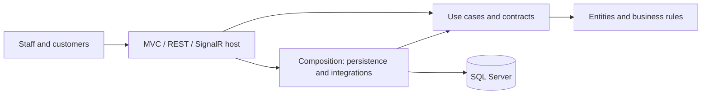
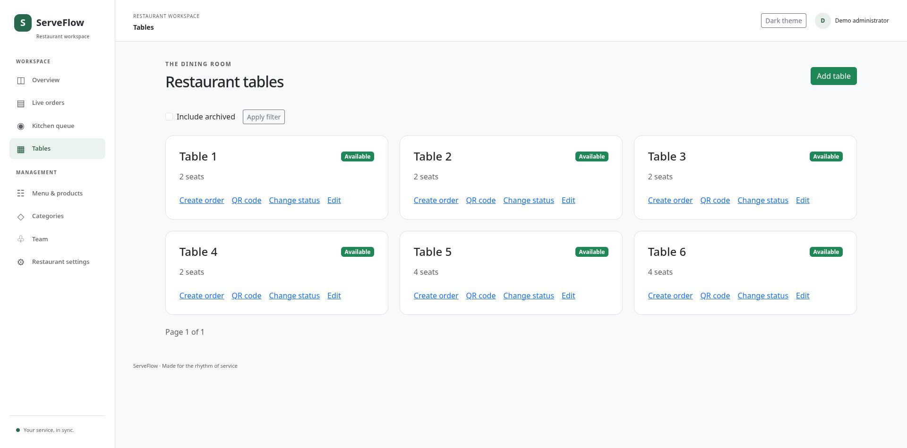

# ServeFlow

Restaurant ordering and management with ASP.NET Core MVC, C#, SQL Server, and real-time kitchen workflows.

**Current milestone: Phase 8 — Testing and deployment preparation.** Podman-built runtime and migration images, real SQL Server tests, production HTTPS workflow checks, generated development demo accounts and GitHub Actions CI are implemented. **247 tests pass with zero skips** against SQL Server 2022. Remote deployment and a hosted CI run remain release gates.

## Start here

Browse [the feature screenshot gallery](docs/feature-gallery.md) for the dashboard, menu, tables, ordering, kitchen, tracking, team and settings.

1. Read [the architecture and entity overview](docs/architecture.md).
2. Follow [Phase 1 setup](docs/phase-1-setup.md) for dependencies, creation commands, configuration, and the complete source-file map.
3. Follow [Phase 2 database setup](docs/phase-2-database.md) to inspect/apply the migration and enable SQL Server tests.
4. Follow [Phase 3 authentication setup](docs/phase-3-authentication.md) to provision your administrator and sign in.
5. Follow [Phase 4 management setup](docs/phase-4-management.md) for menu/table workflows and image storage.
6. Follow [Phase 5 ordering setup](docs/phase-5-ordering.md) for QR origins, carts, receipt capabilities and ordering limits.
7. Follow [Phase 6 real-time setup](docs/phase-6-realtime.md) for kitchen roles, lifecycle rules and SignalR delivery.
8. Follow [Phase 7 analytics setup](docs/phase-7-analytics-ui.md) for metric definitions and the responsive workspace.
9. Follow [Phase 8 Podman and deployment setup](docs/phase-8-deployment.md) to run the full database suite, build images and start a local demo.
10. Use [the delivery roadmap](docs/roadmap.md) to implement subsequent phases.

## Quick start

If you have Podman, use [Phase 8 setup](docs/phase-8-deployment.md). Build the two images, then run `scripts/start-demo.sh` to start the local SQL-backed demo at **http://localhost:5080**. Generated staff credentials are stored privately in `.env.demo`.

Install the latest stable .NET 10 SDK. `global.json` accepts stable 10.0 SDK feature bands; the local environment used for this milestone has SDK 10.0.112. Then:

```bash
dotnet restore ServeFlow.sln
dotnet build ServeFlow.sln --no-restore
dotnet test --solution ServeFlow.sln --no-build
dotnet run --project src/ServeFlow.Web --launch-profile http
```

Open **http://localhost:5080**. The landing page and theme switch work without SQL Server. `/health/live` tests the process. `/health/database` tests connectivity and returns 503 until a reachable database is configured. It does not claim that a schema is present or migrations have been applied.

The committed development connection uses integrated authentication and no password. On Linux, use your SQL Server instance credentials through user secrets or an environment variable; see the setup guide. Both migrations are included; no demo accounts are seeded automatically. Follow the Phase 3 guide to provision an administrator using external credentials.

## Foundation

- Four projects with inward dependencies and centralized package versions.
- Identity-backed SQL Server model, ownership foreign keys, money snapshots, rowversion concurrency, and initial migration.
- EF Core registration, retries, command timeout, and connection validation.
- FluentValidation assembly registration for later use cases.
- Serilog bootstrap and request logging; RFC Problem Details for errors.
- Global MVC antiforgery validation for unsafe requests.
- Local Bootstrap 5 assets, responsive Razor landing page, accessible light/dark theme.
- Staff Identity login/logout, password changes, role policies and employee management.
- Idempotent external-secret administrator provisioning; immediate archived-account/session revocation.
- Restaurant settings, category/product archive and restoration, scoped table statuses and optimistic concurrency.
- Bounded product image decoding/re-encoding and private filesystem storage.
- Secure QR rotation and table cookies, scoped public menus/options, customer/waiter carts and private receipts.
- Transactional server-priced orders, immutable snapshots, initial history and table-scoped idempotency.
- Role-scoped kitchen/staff queues, status history, last-order table release and authorized live receipt updates.
- Actual SignalR transport tests for subscription isolation, reconnect and access revocation.
- Administrator analytics with successful-payment collections, date/time-zone filters, popular products and table occupancy.
- Local Chart.js charts with exact HTML values and responsive role-scoped navigation in both themes.
- Digest-pinned container builds, a separate migration bundle, private development demo provisioning and trusted-proxy configuration.
- Podman SQL tests and production HTTPS smoke checks with real staff cookies and persisted order lifecycle.
- Pinned GitHub Actions verification and release artifacts.
- xUnit configuration/model/validation tests, real cookie/CSRF HTTP tests, and opt-in SQL Server cases.

## Design



Use-case services own transactions and business rules. EF Core is the persistence unit of work; introduce focused repositories when aggregates or complex queries benefit, rather than wrapping every table in generic CRUD.

## Validation

See [verification.md](docs/verification.md) for actual checks performed on this milestone. Live SQL Server tests require `SERVEFLOW_TEST_SQLSERVER`; otherwise they explicitly skip. Cookie and role-policy tests run without SQL Server; transactional Identity/database tests require the test connection. Production deployment still requires the release checks in the runbook.

## Deployment and portfolio

Docker-compatible builds, Podman verification, GitHub Actions, development demo provisioning and screenshots are included. Follow the [Phase 8 runbook](docs/phase-8-deployment.md); no remote deployment or hosted workflow execution is claimed. Production requires TLS, a trusted SQL Server certificate, explicit host allowlisting, managed secrets, persisted/protected Data Protection keys (now enforced), and a controlled migration process.

## Portfolio preview

The SQL-backed development demo completes an unpaid order through kitchen and waiter workflows; its dashboard correctly reports zero collections. More screenshots and setup details are in the Phase 8 guide.


