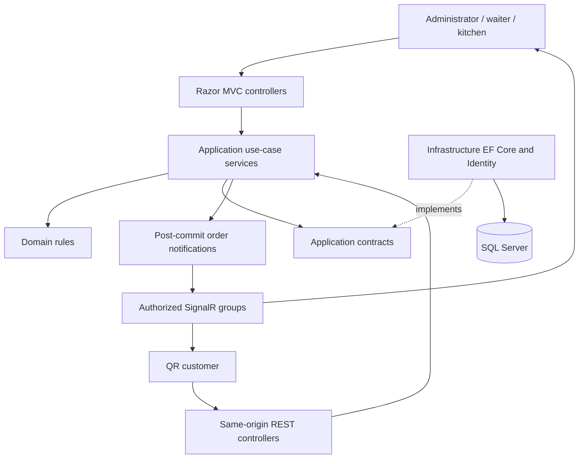
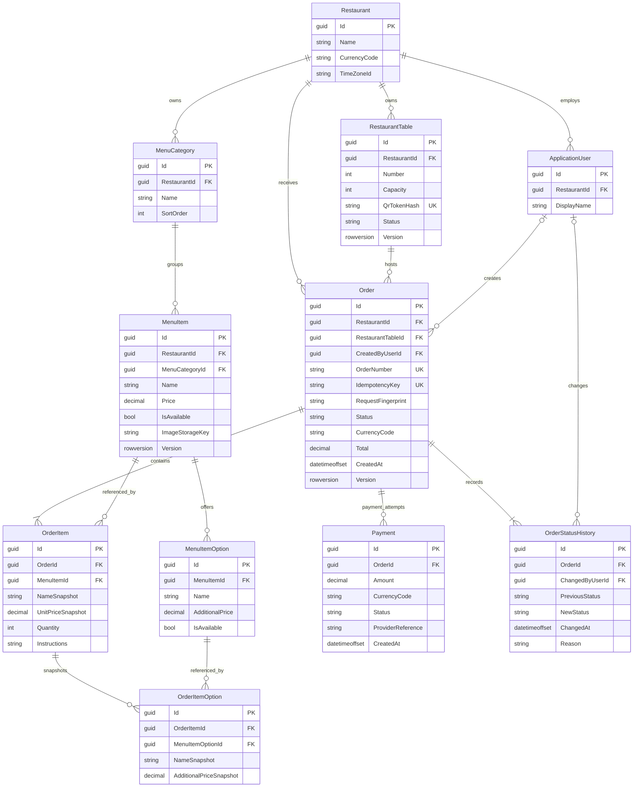

# ServeFlow architecture

## Scope and assumptions

ServeFlow serves a restaurant's menu, tables, customers, kitchen, employees, orders, and payment records. Start with a single restaurant installation while putting `RestaurantId` on restaurant-owned records so later expansion does not require redesigning ownership. Restaurant context must come from trusted configuration or authenticated membership, never solely from a request parameter. A multi-restaurant SaaS product needs a separate tenancy review before deployment.

Phase 1 delivers solution structure, package configuration, the composition root, connectivity health checks, and a small working MVC shell. Phase 2 now implements the model below and the initial migration; Phase 3 now enables staff Identity authentication, role policies and employee management; see [the authentication guide](phase-3-authentication.md).

## Layers and responsibilities

| Project | Responsibility | Allowed dependencies |
| --- | --- | --- |
| `ServeFlow.Domain` | Entities, value objects, order transitions, aggregate invariants | None |
| `ServeFlow.Application` | Use-case services, DTOs, validators, persistence/current-user/event contracts | Domain, validation and DI abstractions |
| `ServeFlow.Infrastructure` | EF Core SQL Server, Identity persistence, uploads and external integrations | Application, Domain transitively |
| `ServeFlow.Web` | Razor MVC, versioned APIs, SignalR hubs, authentication UI, ViewModels and startup | Application; Infrastructure only for composition and operational health |
| `ServeFlow.UnitTests` | Pure business and configuration behavior | Target layer |
| `ServeFlow.IntegrationTests` | HTTP pipeline, permissions and real SQL Server behavior | Web |

The initial deployment is a modular monolith with one Web host. MVC and REST endpoints share services and validation; neither controller nor hub contains order logic. Do not add microservices, a generic repository for every entity, or a mediator framework without a concrete need. Use scoped services/DbContext and asynchronous database calls with cancellation. Avoid returning EF entities directly to clients. SignalR messages follow a committed transaction; later use an outbox for reliable delivery across failures.

## Authorization design

| Capability | Administrator | Waiter | KitchenStaff | Anonymous customer |
| --- | --- | --- | --- | --- |
| Restaurant settings, employees, menu CRUD | Yes | No | No | No |
| Table management and staff order creation | Yes | Yes | No | No |
| Read kitchen queue, accept/prepare/ready | Yes | No | Yes | No |
| Serve/complete an order | Yes | Yes | No | No |
| Analytics, payment reconciliation | Yes | No | No | No |
| Browse public menu | Yes | Yes | Yes | Yes |
| Submit and track table order | Staff workflow | Staff workflow | No | Valid table session and order receipt only |

Administrator, Waiter, KitchenStaff and Customer are the role names. Anonymous QR customers are not Identity users and do not acquire a role by supplying its name. A future registered Customer role is separate from guest table capabilities. The customer's table session and per-order receipt must constrain every read/write, including SignalR group membership. Public table QR possession alone must not expose previous diners' order histories. Administrative cancellation and payment reconciliation need auditable policies.

## Database relationship overview (implemented in Phase 2)

Identity contributes its standard role, claim, login, token, and user-role tables in addition to `ApplicationUser`; they are omitted above for readability. Identity types belong in Infrastructure so Domain remains framework-independent. Actor references in Domain can be nullable GUIDs mapped to Identity foreign keys by EF.

## Persistence constraints

- Use GUID primary keys, `DateTimeOffset` UTC timestamps, and SQL Server `rowversion` concurrency tokens on mutable aggregates. Return HTTP 409 for stale writes and require current versions on staff mutations.
- Enforce same-restaurant ownership in services **and** composite alternate keys/foreign keys such as `(RestaurantId, MenuCategoryId)` and `(RestaurantId, RestaurantTableId)`. The diagram shows conceptual links; EF mappings add the tenant columns needed for these constraints. User assignment must obey the same ownership check.
- Store money as `decimal(18,2)` for the first two-decimal-currency release; round with a documented rule and persist order currency. Do not use floating point. Snapshot item/option names and prices at checkout; `Total = sum(quantity × (unit price + selected option prices))`. Tax, discounts, refunds, split bills, and other currency precision require explicit future rules.
- Unique indexes: `(RestaurantId, TableNumber)`, QR token hash, `(RestaurantId, OrderNumber)`, `(RestaurantId, TableId, IdempotencyKey)`, and filtered provider/payment reference where present. Compare request fingerprints on idempotency reuse; reject a reused key with changed contents.
- Index order queue `(RestaurantId, Status, CreatedAt)`, reporting `(RestaurantId, CreatedAt)`, and all foreign keys. Check constraints prohibit nonpositive quantities and negative money values. Bound notes, names, and option counts in validators and columns.
- Use restricted/no-action deletes on historical order references; archive menu entries/tables/employees rather than deleting history. Cascade order-owned item/option rows only if permitted by an explicit retention policy. Avoid SQL Server multiple cascade paths.
- Successful payments contribute to collections; Pending/Failed attempts never count as collected revenue. Distinguish collected cash from completed-order sales in reports. Validate provider webhooks and deduplicate external references. Never store PANs, CVVs, or raw card payloads.

## Ordering and operational invariants

A server service resolves current availability and option membership, calculates totals, snapshots prices, and inserts the order/history inside one transaction. Serializability or deliberate aggregate locking must protect availability/table decisions; EF retry execution strategies must wrap manually managed transactions. Generate public order numbers with a database-backed unique strategy and never `count + 1`.

The main order progression is `Pending → Accepted → Preparing → Ready → Served → Completed`. Define cancellation policy before implementation: pending orders may be cancelled by authorized owners/staff; preparing orders require an administrator reason; completed orders are immutable and use separate refunds. Every allowed transition, actor policy, and history record is validated atomically.

Generate at least 256 bits of cryptographic randomness for table QR capabilities; hash tokens at rest, support rotation/revocation, and exchange them for an HttpOnly table-session cookie. QR printing/rotation is a staff action. Issue a distinct scoped order receipt. Keep tokens out of access logs and referrers. Combine bounded request sizes, per-IP and per-table throttling, idempotency keys, order count limits and abuse monitoring.

Authentication uses ASP.NET Core Identity cookies. Unsafe MVC and cookie-authenticated REST requests use antiforgery tokens (including Fetch headers). No mutation through GET; no arbitrary hub group joining. Apply server-side FluentValidation explicitly and asynchronously. File uploads need signature/type/size validation, generated filenames, image decoding/re-encoding, and storage outside the executable web root. EF parameterization provides SQL injection protection; never concatenate user SQL.

Configure proxy trust explicitly before forwarded headers, persist Data Protection keys for scaled deployments, use a shared SignalR backplane when needed, and plan backups/restore drills. Apply reviewed migrations as a deployment job rather than automatic startup migration. Health connectivity and schema readiness are separate checks. These controls are staged with their owning features; see the milestone guides for implemented behavior and remaining checks.
