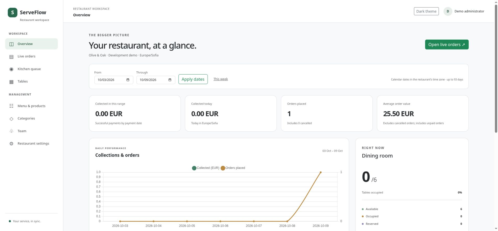
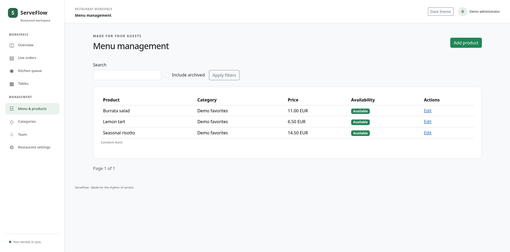
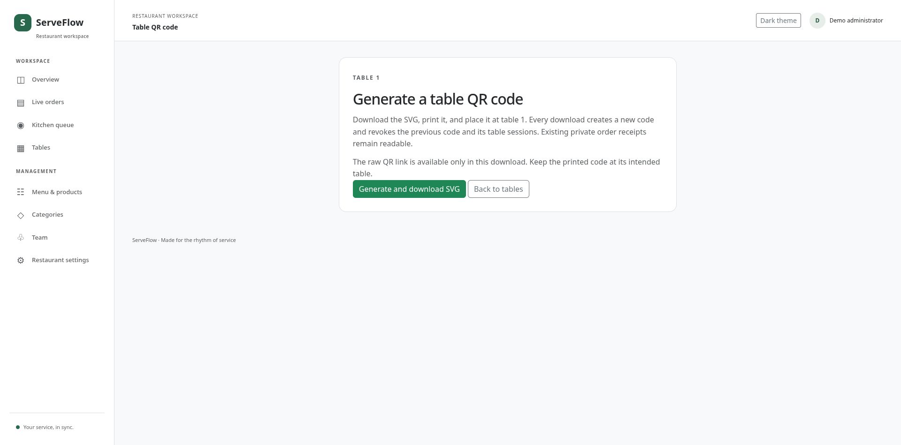
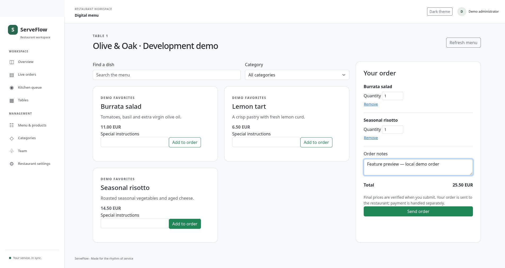
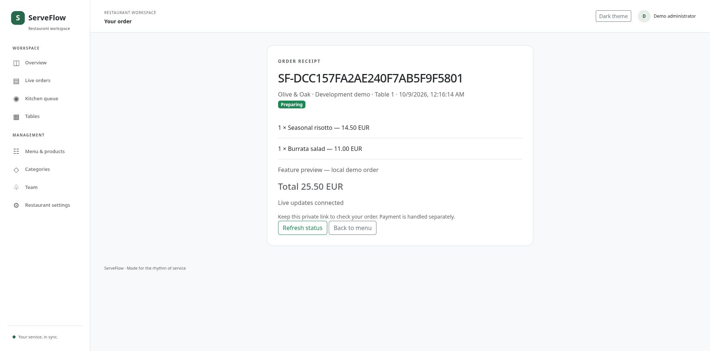
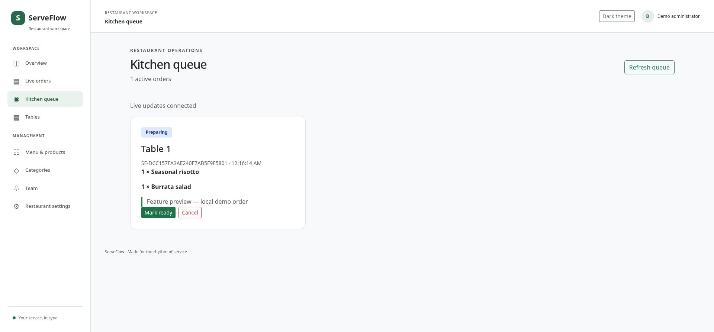
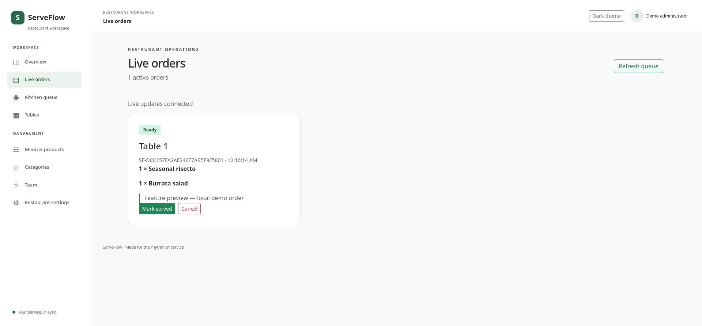
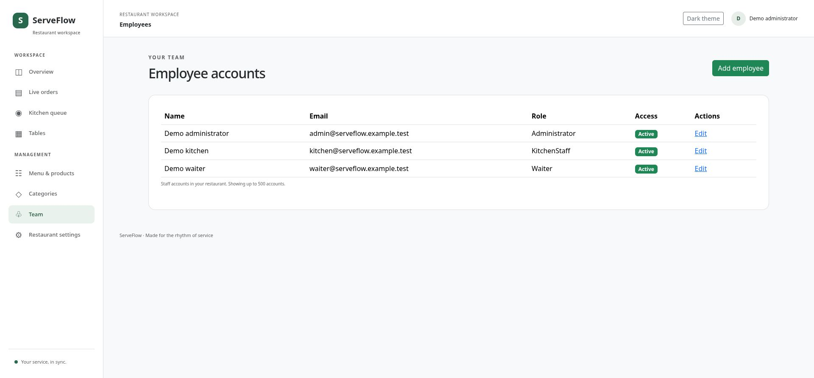
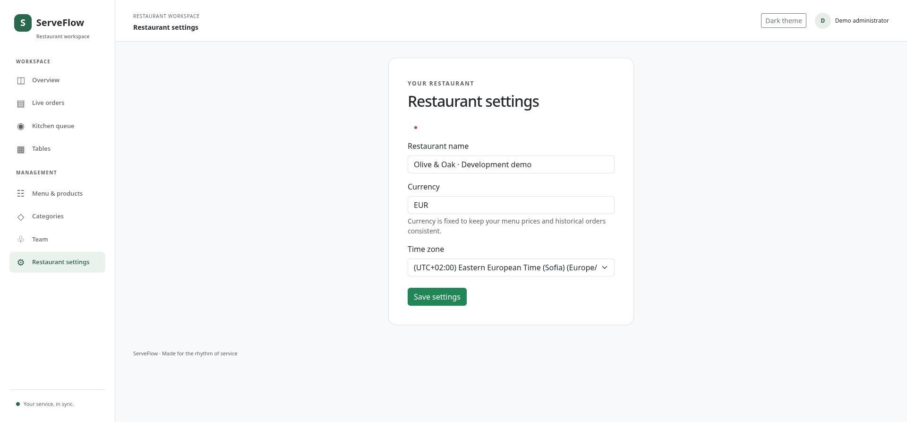

# ServeFlow feature screenshots

Captured on 9 October 2026 from the running local Podman demo at localhost:5080, backed by SQL Server. These are actual application screenshots using synthetic development data.

The screenshot workflow created and completed one EUR 25.50 demo order. Its receipt updated live through the kitchen and service states; the dashboard confirms all six tables are available afterward. No payment was recorded.

## Dashboard overview

Date filters, order metrics, daily collections and dining room occupancy. The demo order is unpaid, so collected amounts remain zero.

## Menu management

Products, categories, prices, availability, search and editing controls.

## Restaurant tables

Six demo tables with seating capacity, availability and ordering controls.

## Table QR management

The secure QR generation and download screen. No usable QR capability is included in this gallery.

## Digital menu and cart

The staff table-ordering view with two dishes, quantities, notes and a EUR 25.50 total.

## Live order tracking

The private receipt updates to Preparing while the kitchen works on the order.

## Kitchen preparation

A real demo order in Preparing, with dishes, notes and the Mark ready action.

## Service handoff

The Ready order appears in the live queue for serving.

## Completed receipt

The same demo order reaches Completed. Completion is separate from payment.

## Team management

Synthetic administrator, kitchen and waiter accounts with their roles and access status.

## Restaurant settings

Restaurant name, fixed currency and time zone configuration.

