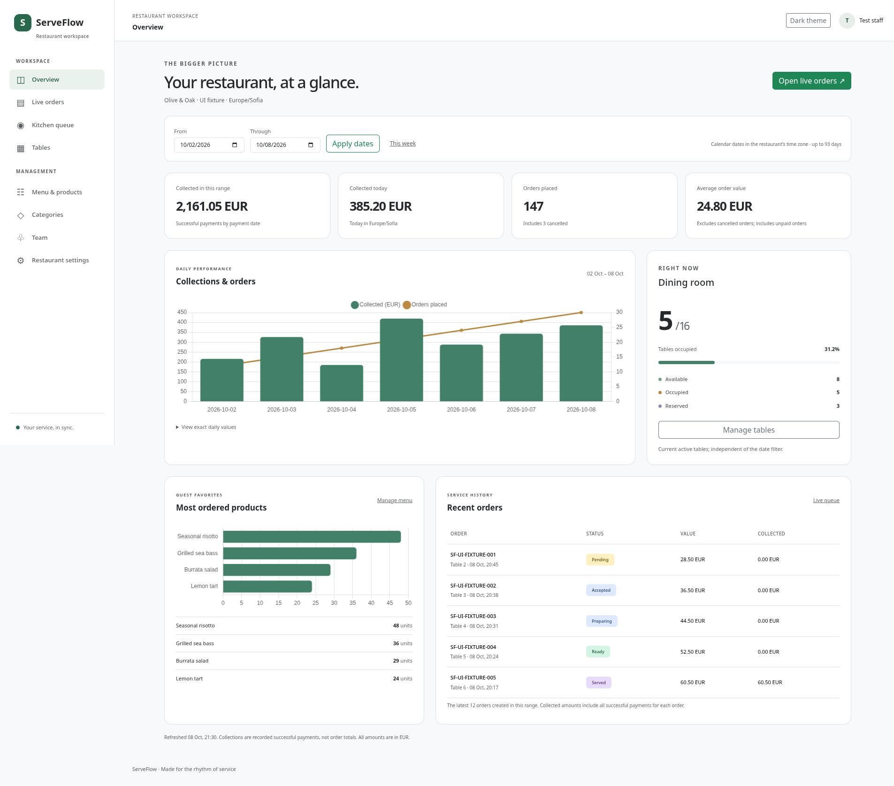

# Phase 7 — Analytics and responsive workspace

The administrator dashboard is available at `/Dashboard`. Configure SQL Server, apply the existing migrations and provision/sign in as an administrator using the Phase 2 and 3 guides. Choose **Overview** in the staff sidebar. No new migration or configuration secret is required. Waiters and kitchen staff retain their operational navigation but cannot read analytics. The service rechecks stored active membership and administrator role before selecting the restaurant; request fields cannot select another restaurant.

## Metric definitions

| Metric | Definition |
| --- | --- |
| Collected in this range | Sum of Succeeded payment amounts with a non-null PaidAt within the selected restaurant calendar dates |
| Collected today | Successful payments within today's restaurant calendar day, independently of the selected filter |
| Orders placed / daily orders | Orders created within the selected dates; includes cancelled orders |
| Average order value | Stored Total of non-cancelled selected orders divided by their count; decimal rounding to two places, midpoint away from zero; unpaid orders included |
| Most ordered products | Top ten products by summed line quantity from non-cancelled selected orders; current menu name, historical quantities |
| Recent orders | Latest twelve orders created within the range; stored order totals and cumulative successful payments for each order, including payments outside the filter |
| Dining room | Current non-archived table statuses; occupied / all active tables, including reserved tables in the denominator |

Money metrics, order counts and product rankings select only the restaurant's configured currency; no exchange conversion is inferred. Table occupancy is independent of currency and dates. Successful payments on subsequently cancelled orders still count: cancellation does not reverse a payment. Refund accounting and payment-provider integration are not implemented. Completed orders are not assumed paid. Phase 7 reads existing payment records; it introduces no payment-recording UI or automatic payment seed. A restaurant with orders but no successful payments correctly shows zero collections.

Date filters are inclusive calendar dates, from 2000 through 2100, with a maximum of 93 days; the default is today and the previous six days. Start midnight is inclusive and midnight after the last date is exclusive. TimeZoneInfo handles restaurant time zones, including 23/25-hour daylight-saving days and fractional offsets. A missing local midnight advances to the first valid minute; an ambiguous midnight uses the earliest occurrence. SQL predicates apply exact UTC bounds before grouping. SQL Server aggregates payment sums and order counts into UTC minute buckets using DATEDIFF; the application assigns those bounded buckets to local dates and fills empty days. This avoids loading individual payment records or depending on SQL Server's Windows time-zone names. Present-day supported offsets use minute precision. Queries execute sequentially under the existing isolation settings: concurrent writes can make cards differ slightly during a refresh; this is an operational view, not a reconciled accounting export.

## Workspace behavior

The shared staff layout has role-scoped navigation, active-page indication, an account menu and persisted light/dark themes. On small screens the sidebar becomes a dialog with a backdrop, close button, keyboard focus containment, background inertness and Escape/focus restoration. The dashboard stacks cards/panels, keeps date fields readable, and confines wide recent-order tables to their own scrolling container. Exact daily values are available in an HTML table and popular quantities remain a visible list. Charts respect reduced motion and theme changes. Chart failure does not remove the underlying HTML data. Mobile navigation requires JavaScript.

Chart.js 4.5.1 is served locally, with its MIT license, source map, npm integrity and asset hashes under `wwwroot/lib/chartjs`. Chart data is Razor-encoded in a data attribute; no inline executable script or remote CDN is required. Dashboard responses are private/noncached and analytics reads use a 20-request-per-minute staff-account limit.

## Files added or changed

Paths below are relative to the repository root.

| Files | Responsibility |
| --- | --- |
| `src/ServeFlow.Application/Analytics/AnalyticsContracts.cs` | Read contract and dashboard DTOs |
| `src/ServeFlow.Application/Analytics/AnalyticsPeriod.cs` | Calendar boundaries, series filling and decimal averages |
| `src/ServeFlow.Infrastructure/Analytics/AnalyticsService.cs` | Stored authorization, scoped metrics and dashboard queries |
| `src/ServeFlow.Infrastructure/Analytics/AnalyticsQueries.cs` | Shared SQL aggregate expressions tested for translation |
| `src/ServeFlow.Infrastructure/DependencyInjection.cs` | Analytics and TimeProvider registration |
| `src/ServeFlow.Web/Controllers/DashboardController.cs` | Administrator GET endpoint and range errors |
| `src/ServeFlow.Web/Program.cs` | Rate limiting and private-response headers |
| `src/ServeFlow.Web/Views/Dashboard/Index.cshtml` | KPI cards, filters, charts, tables and empty/error states |
| `src/ServeFlow.Web/Views/Shared/_Layout.cshtml`, `_StaffSidebar.cshtml` | Responsive staff shell and scoped navigation |
| `src/ServeFlow.Web/wwwroot/css/site.css` | Sidebar, responsive dashboard and theme styles |
| `src/ServeFlow.Web/wwwroot/js/site.js`, `dashboard.js` | Theme/sidebar interactions and local chart rendering |
| `src/ServeFlow.Web/wwwroot/lib/chartjs/*` | Licensed pinned chart assets and provenance |
| `tests/ServeFlow.UnitTests/AnalyticsTests.cs` | Fifteen date, arithmetic, occupancy and SQL-translation cases |
| `tests/ServeFlow.IntegrationTests/DashboardHttpTests.cs`, `AuthenticationTests.cs` | Eight real cookie/policy/Razor HTTP cases using an analytics fixture |
| `tests/ServeFlow.IntegrationTests/AnalyticsSqlServerTests.cs` | Four opt-in real SQL aggregation/ownership cases |
| `docs/screenshots/phase-7-desktop-fixture.jpg`, `phase-7-mobile-fixture.jpg` | Browser review evidence with test-only data |
| `README.md`, `docs/roadmap.md`, `docs/verification.md`, this guide | Milestone, setup and actual validation record |

## Validation and live checks

Release build: zero warnings/errors. Suite: **195 passed, 0 failed, 40 skipped (235 total)**. JavaScript syntax and EF pending-model checks pass; no schema change. The new unit cases verify daylight-saving duration, exclusive boundaries, zero filling, fractional offsets, midnight gaps, decimal rounding, range rejection and actual EF SQL aggregate translation. HTTP cases verify anonymous/role restrictions, date errors, private rendered responses and safe chart-data encoding. See [verification](verification.md) for scope.

Desktop light/dark and a 390px-wide mobile iframe were inspected in Chrome using actual Razor output with explicitly labelled **UI fixture** data. The review found and corrected narrow date fields and panel overflow; the final mobile document width equals its scroll width. Sidebar opening and Escape/focus restoration were checked. This review proves rendering and selected interactions, not persisted database workflows or native phone behavior. The fixture exists only in tests; setting `SERVEFLOW_UI_CAPTURE_DIR` when running tests optionally exports its rendered page for local review.

No SQL Server test connection is configured here. Four new SQL cases therefore skip, alongside the 36 prior cases. They cover successful/partial versus pending/failed payments, cancelled orders, currency separation, unchanged money after menu repricing, local payment-date boundaries, empty metrics, archived-table exclusion and stored ownership/account access. Configure `SERVEFLOW_TEST_SQLSERVER` as described in Phase 2, then run the full suite before release. Verify dashboard figures against known persisted payments, test dates over DST changes, and exercise existing management/ordering pages with each staff role in the new shell.

Phase 8 remains the next milestone: deployment packaging, CI, full database/container checks, demo provisioning and portfolio evidence. Existing single-instance SignalR limits still apply.

## Reviewed UI fixture

